# TARA-App — Feature & Neural-Network Diagrams

> **Accuracy note:** These diagrams are architecture documentation, not a claim that every feature is fully integrated or production-verified. Status is governed by [REMAINING_FEATURES.md](REMAINING_FEATURES.md) and [Project Status & Roadmap](PROJECT_STATUS_AND_ROADMAP.md). The neural-network internals below describe a generic Transformer model behind OmniRoute; TARA-App does not implement, train, own, or load those model weights.

## 1. Complete feature map

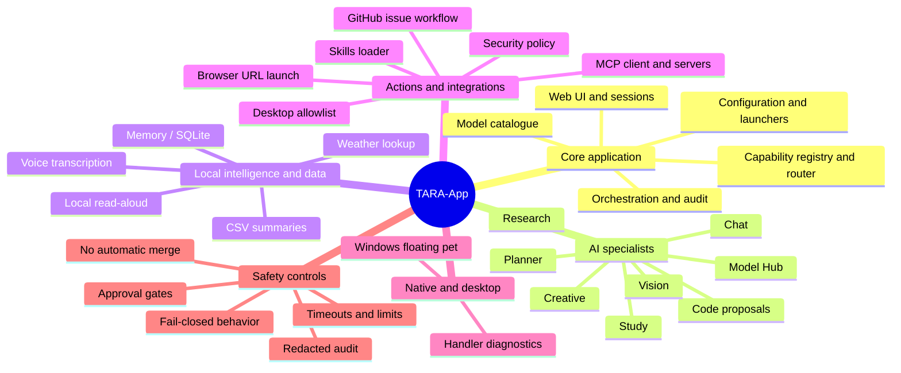

## 2. Capability routing and specialist dispatch

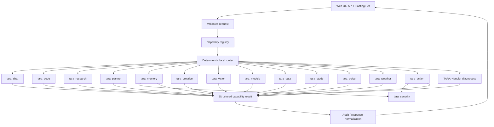

## 3. Chat, conversation history and memory

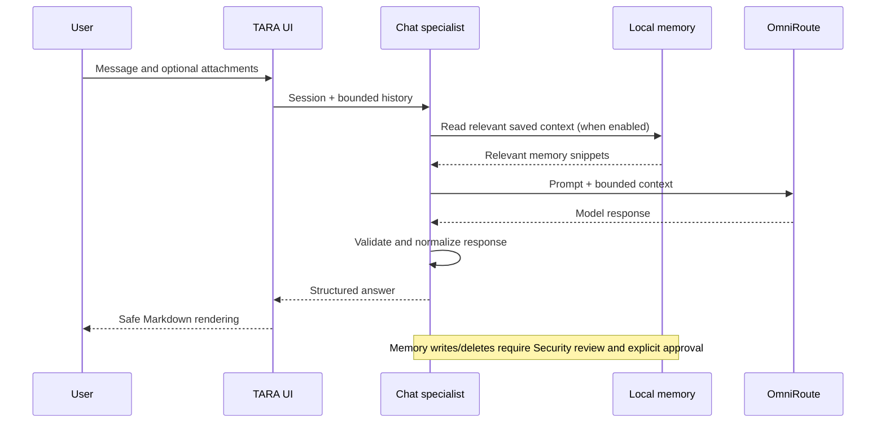

## 4. Code specialist — current and gated future

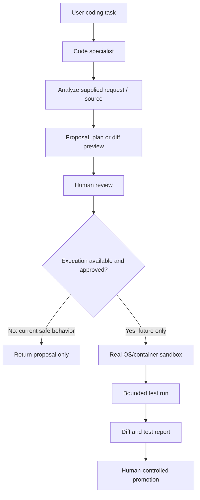

**Current limitation:** Code generation/planning is review-first. Workspace mutation and generated-code execution are blocked pending a real OS/container sandbox and security verification. No model-generated host shell commands.

## 5. Research and source review

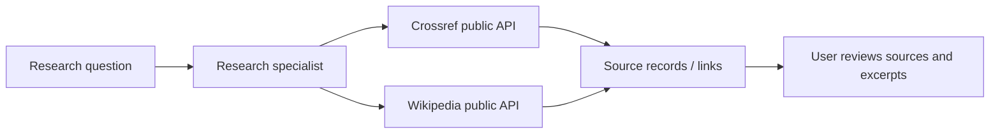

## 6. Planner and bounded workflow engine

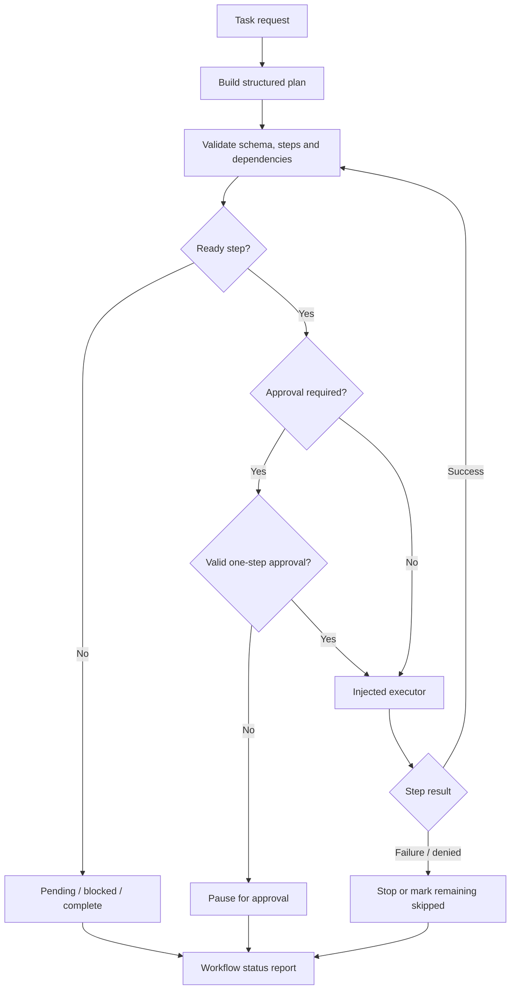

## 7. Security, permissions and audit

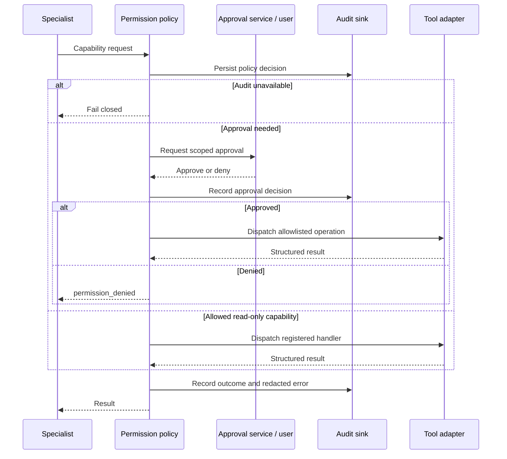

## 8. Desktop actions and browser opening

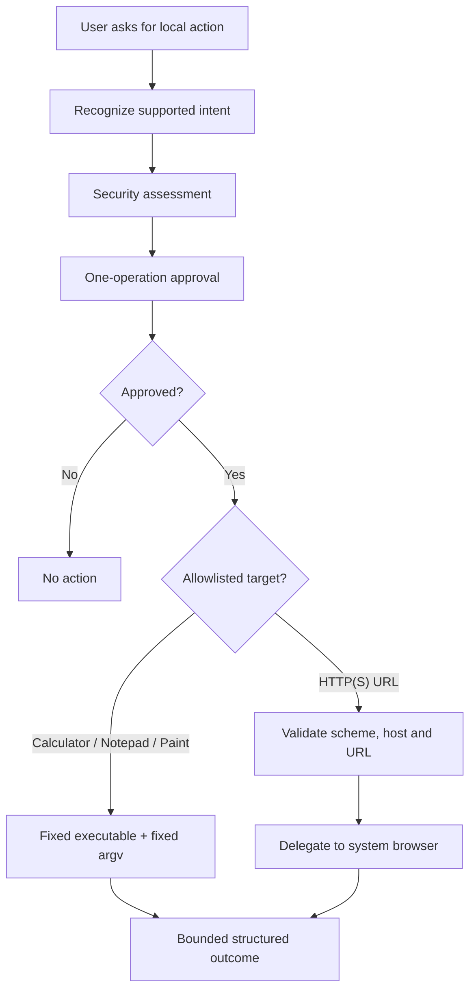

## 9. TARA-Handler native diagnostics and maintenance boundary

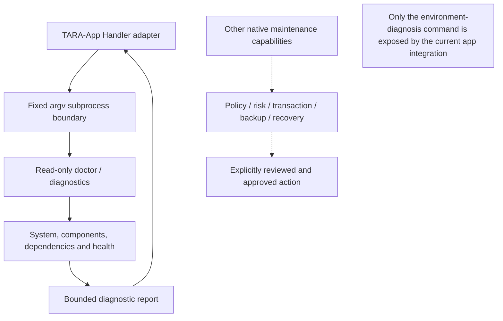

## 10. Model Hub and OmniRoute model catalogue

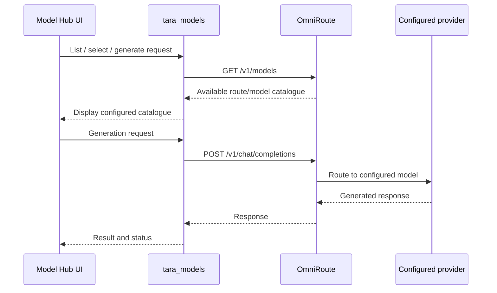

## 11. Generic neural network: Transformer inference

> **Conceptual model internals.** This is a generic decoder-only Transformer illustration. The actual architecture, layer count, attention variant, tokenizer, context size and weights depend on the model selected by the OmniRoute provider and are not discoverable from this repository's app code alone.

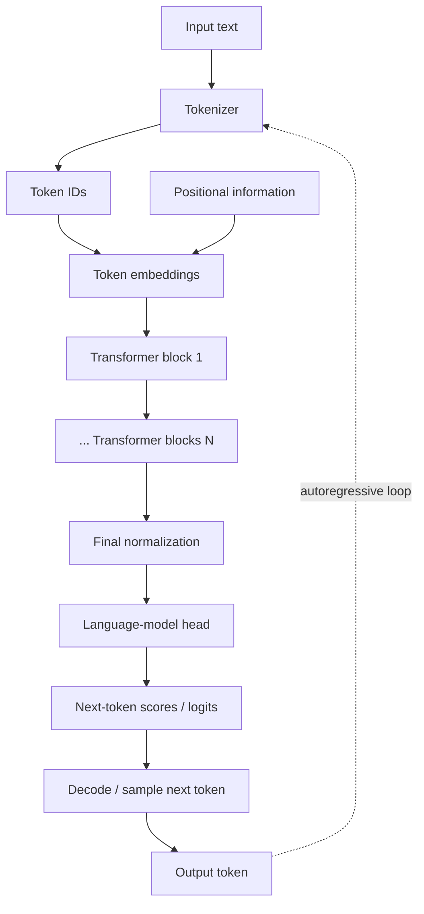

## 12. Inside a generic Transformer block

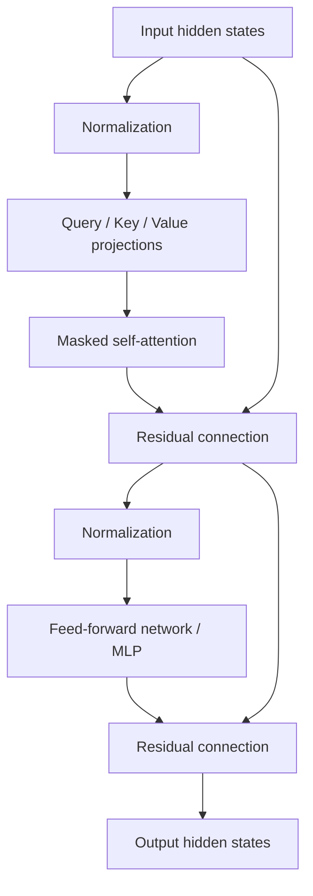

## 13. Attention mechanism — conceptual

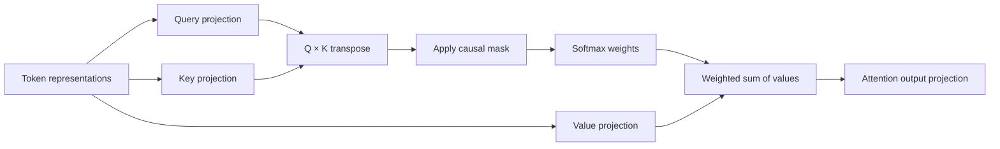

## 14. Neural-network training versus TARA inference

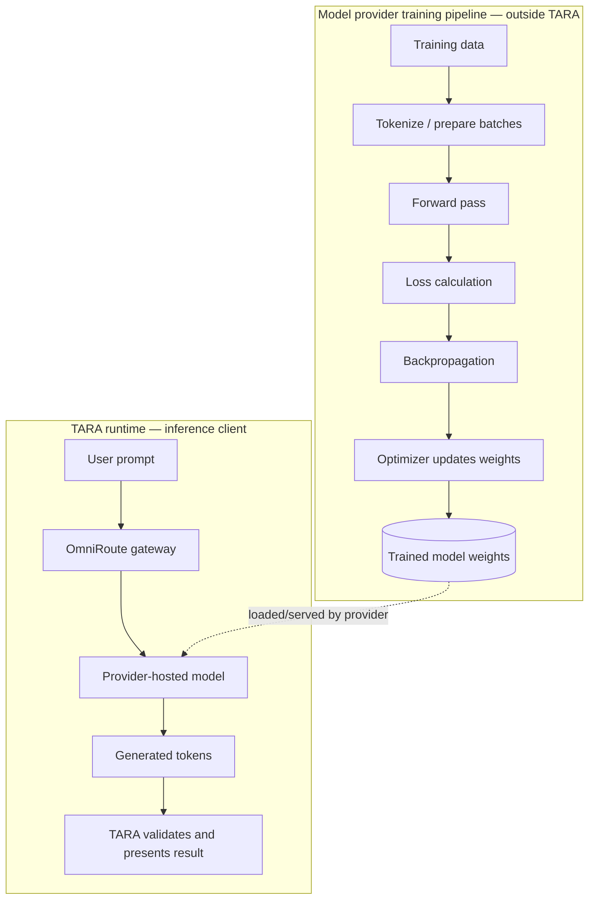

## 15. Vision, voice and multimodal paths

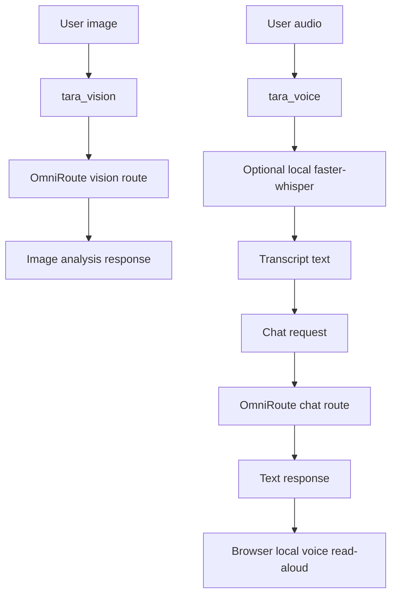

## 16. Study, Data and Weather utilities

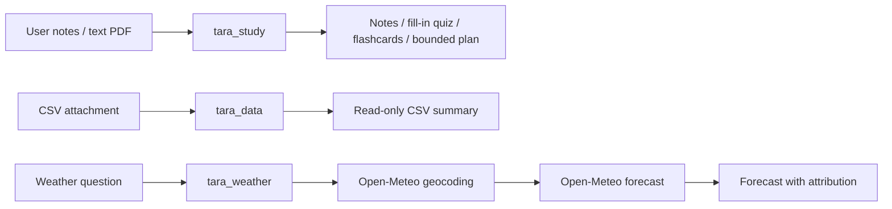

## 17. MCP tools and skills

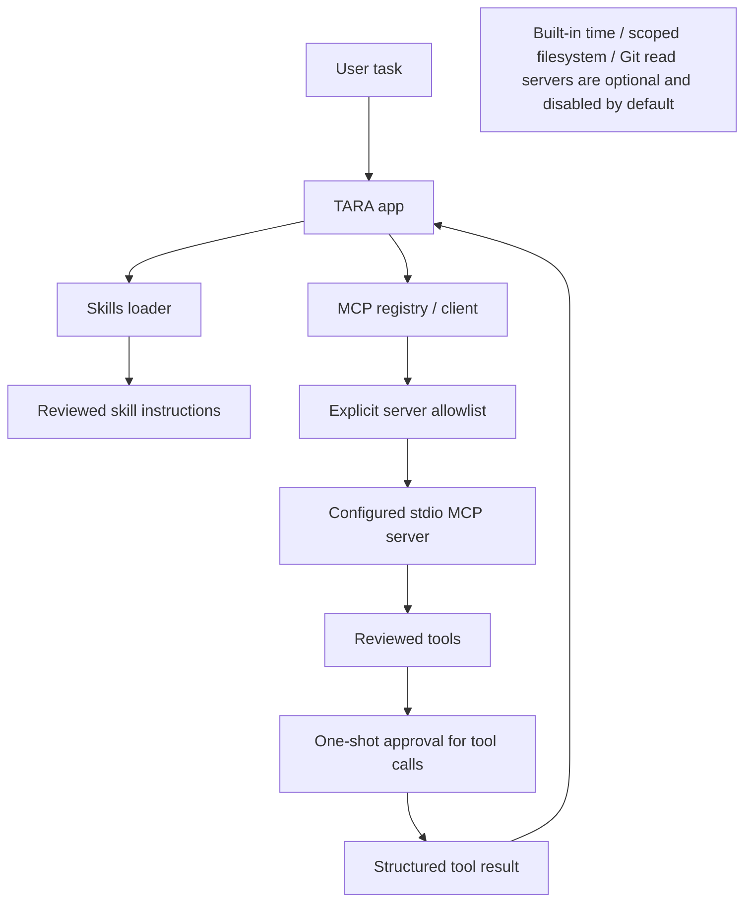

## 18. Windows floating companion

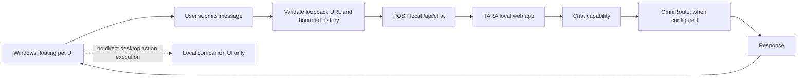

## 19. Startup and deployment

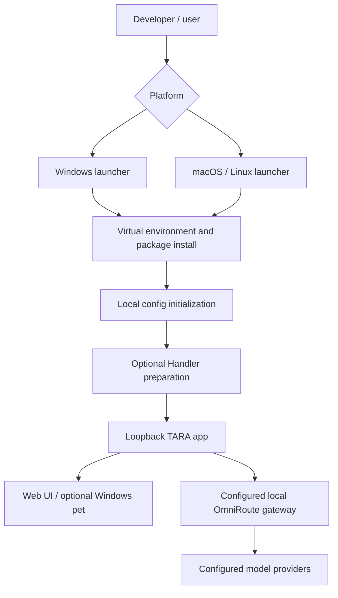

## 20. Failure handling and fail-closed behavior

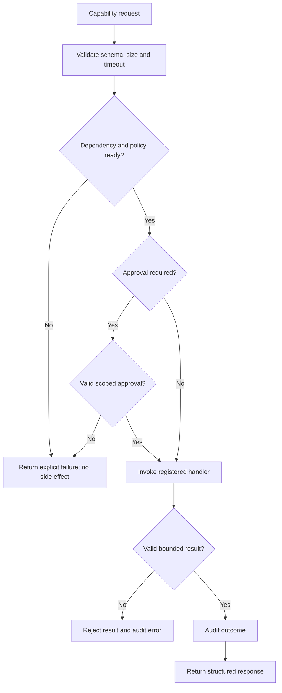

## Related authoritative project documents

- [Architecture](ARCHITECTURE.md)
- [Security model](SECURITY.md)
- [Remaining feature status](REMAINING_FEATURES.md)
- [Project history and roadmap](PROJECT_STATUS_AND_ROADMAP.md)
- [Integration contracts](INTEGRATION_CONTRACTS.md)
- [OmniRoute integration](OMNIROUTE_INTEGRATION.md)
- [Main README](../README.md)
